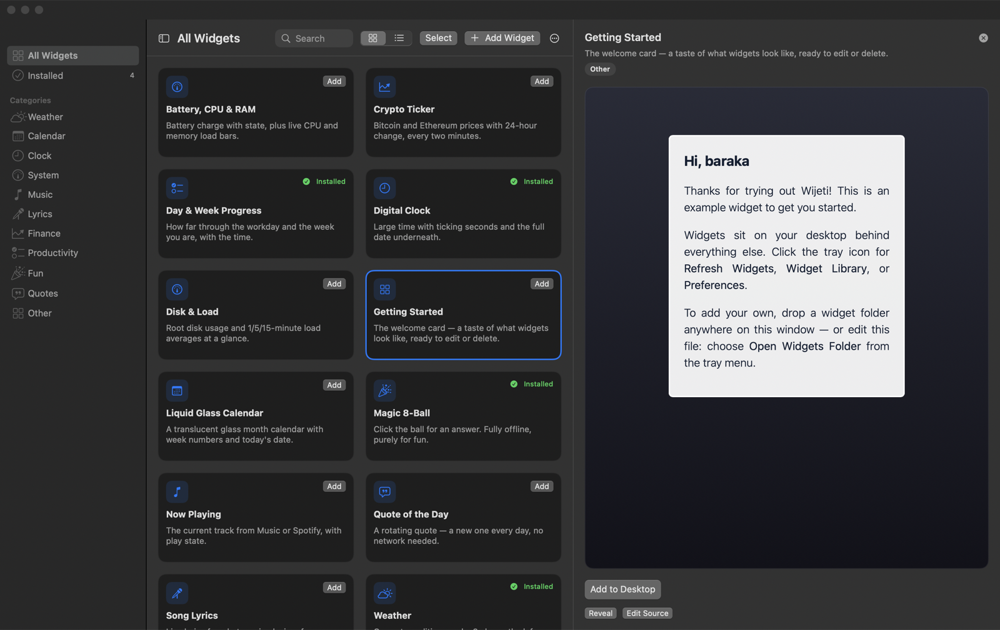
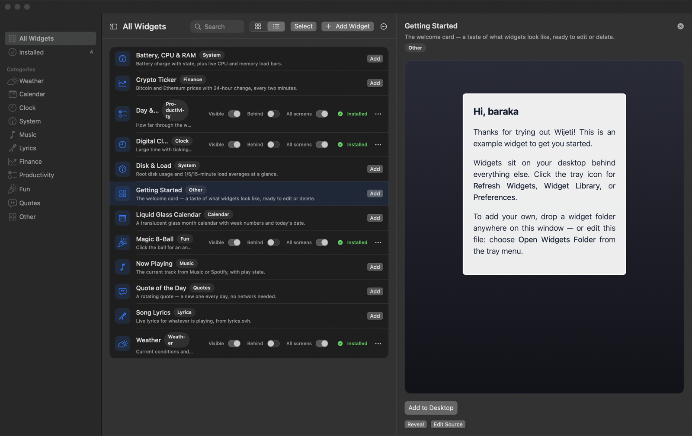
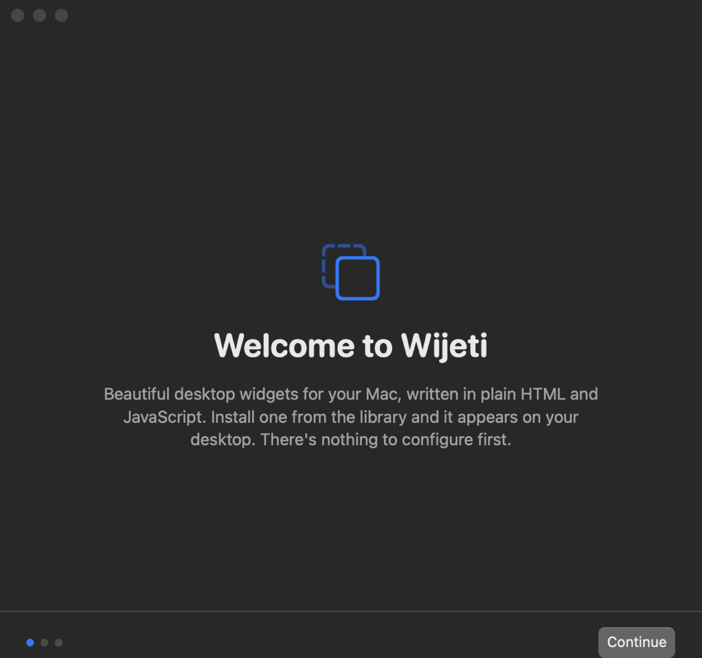
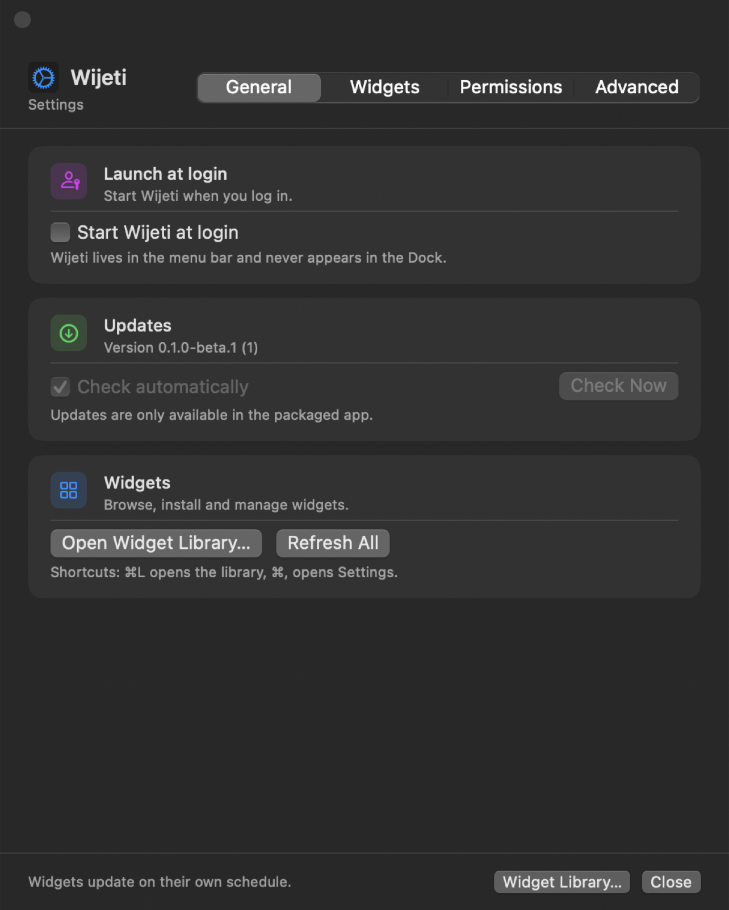
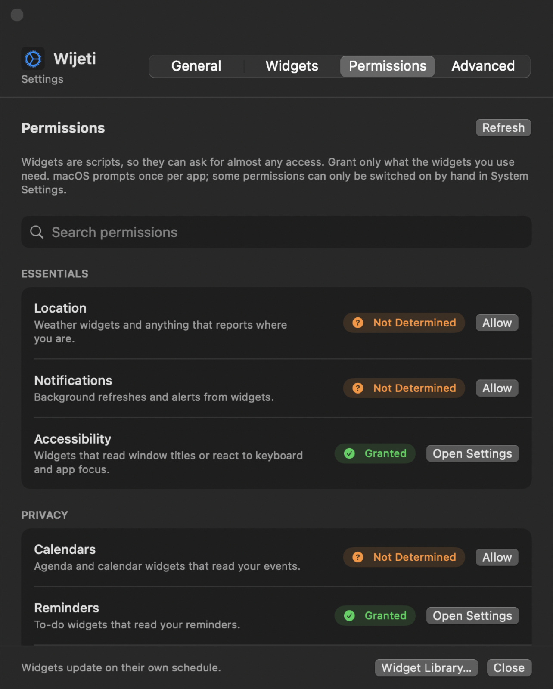
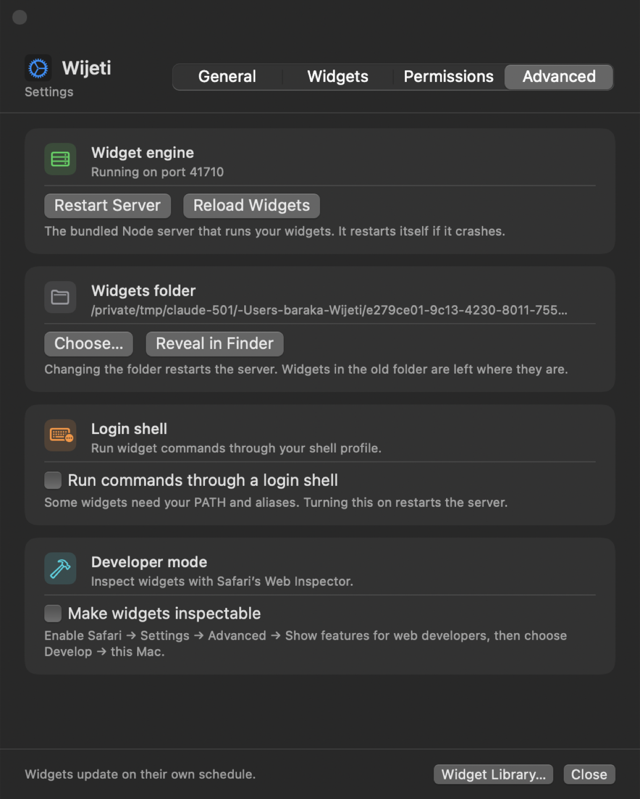

<p align="center">
  
</p>

<h1 align="center">Wijeti</h1>

<p align="center">Native desktop widgets for macOS, written in HTML and JavaScript.</p>

<p align="center">
  <a href="https://github.com/wakilibaraka/Wijeti/releases/latest"><b>Download</b></a> ·
  <a href="INSTALL.md">Install guide</a> ·
  <a href="RELEASE_NOTES.md">Release notes</a> ·
  <a href="https://www.paypal.com/donate/?business=wakilibar%40gmail.com&currency_code=USD">Donate</a>
</p>

A native Swift desktop widget host for macOS: the spirit of
[Übersicht](https://github.com/felixhageloh/uebersicht) rewritten in Swift, with a menu bar app, a
widget library with live preview, and permissions that cover what widgets actually need.

> **Beta.** Wijeti `0.1.0-beta.1` is ad-hoc signed and not notarized. Follow
> **[INSTALL.md](INSTALL.md)** for the safe one-time steps to open it.

<p align="center">
  
</p>

## Download

Pick the build that matches your Mac from the
[Releases](https://github.com/wakilibaraka/Wijeti/releases) page:

| Mac | File |
| --- | --- |
| Apple Silicon (M1 and later) | `Wijeti-<version>-arm64.dmg` |
| Intel | `Wijeti-<version>-x86_64.dmg` |

Requires macOS 15 or later. Updates arrive automatically (Settings → General → Updates).

## Features

- **Widget Library (⌘L).** Grid or list, foldable category sidebar, search, live preview, and
  multi-select with bulk show / hide, placement, category and remove.
- **Add your own (⌘N).** `.zip`, folders, `.jsx` / `.js` / `.coffee` or plain `.html` pages; then
  name and categorize them. Right-click anything for its menu.
- **Permissions.** About 25 permissions (Automation per app, Calendars, Camera, Bluetooth, Full
  Disk, …) with live status and one-click prompts. Pressing **Allow** next to an app under
  Automation is what makes Wijeti appear in System Settings → Privacy & Security → Automation.
- **Menu bar.** Health indicator (Active / Reloading / Stopped), Add Widgets, Refresh, Reload,
  Preferences, Check for Updates.
- **Settings.** General, Widgets, Permissions, Advanced (engine health, restart, developer mode).
- **AppleScript.** `refresh`, `reload`, `count widgets`, and `every widget` with properties.

## Screenshots

| Library (list view) | Onboarding |
| --- | --- |
|  |  |

| Settings | Permissions | Advanced |
| --- | --- | --- |
|  |  |  |

## Writing a widget

A widget is a folder containing `index.jsx` (or a single `.jsx` / `.coffee` / `.js` file):

```jsx
export const refreshFrequency = 1000;
export const command = "date '+%Y-%m-%d %H:%M'";

export const render = ({ output }) => <div>{output}</div>;
```

Drop it on the Widget Library window, or press **Add Widget**. Wijeti never needs you to open the
widgets folder (`~/Library/Application Support/Wijeti/widgets`) yourself.

## Keyboard shortcuts

| Shortcut | Action |
| --- | --- |
| `⌘L` | Widget Library |
| `⌘N` | Add Widgets (menu bar) |
| `⌘,` | Preferences |
| `⌘A` | Select all shown (Library) |
| `⌘⌃S` | Fold / unfold the category sidebar |
| `⌘Q` | Quit |

## Build from source

Requires macOS 15+, Xcode 16+ (`xcode-select --switch /Applications/Xcode.app`).

```sh
git clone https://github.com/wakilibaraka/Wijeti.git && cd Wijeti
./Scripts/build-runtime.sh                 # once: assembles server/release (Node + widget engine)
ARCH=arm64 ./Scripts/build-app.sh          # or ARCH=x86_64 → build/<arch>/Wijeti.app
cp -R build/arm64/Wijeti.app /Applications/
```

`build-app.sh` ad-hoc signs by default and keeps `com.apple.security.cs.disable-library-validation`
(without it the bundled Node aborts loading `fsevents.node` with a Team-ID mismatch). Set
`SIGN_IDENTITY="Developer ID Application: …"` to sign with a real identity.

## Releasing

```sh
./Scripts/release.sh
```

Runs the tests, builds **both** architectures, packages `dist/<arch>/Wijeti-<version>-<arch>.dmg`
with a SHA-256 file, and signs/updates the per-architecture Sparkle feeds in `updates/`. The version
lives in `VERSION` and `BUILD_NUMBER`. See the printed commands for tagging and publishing.
Update downloads are signed with an EdDSA key held in the maintainer's Keychain
(`Sparkle/bin/generate_keys`); keep a backup of it, because losing it means existing installs can
no longer verify updates.

## Troubleshooting

- Blocked on first open → [INSTALL.md](INSTALL.md).
- A widget does nothing → Settings → Permissions; Automation needs **Allow** per app.
- Logs (home folder already shortened to `~`):
  `log show --last 30m --predicate 'process == "WijetiApp"' --style compact`

## Architecture

- **Widget engine.** The `server/` directory is Übersicht's widget runtime, used unchanged
  and running as a separate process. Wijeti talks to it over a local socket.
- **Swift side.** `WijetiCore` owns the model, the server supervisor, the settings store, and
  the preset catalog. `WijetiMacOS` is the AppKit host: tray, windows, web views, preferences,
  onboarding. `WijetiApp` is the executable entry point and the AppleScript delegate.
- **Scripting.** The AppleScript dictionary is `Resources/Wijeti.sdef`. Two rules learned the
  hard way are load-bearing there: command codes must be exactly eight characters, and classes
  and properties need real Cocoa bindings.

## Roadmap

Near term: notarized builds, a second widget format (HTML packages with typed variables), an
in-app code studio, and portability groundwork for other systems.

## Credits

The widget engine in `server/` is Übersicht's, by Felix Hageloh — GPL-3.0 licensed, and used
unchanged. Wijeti is an independent Swift reimplementation of the host application.

## License

Wijeti is free and open-source software under the **GNU General Public License v3.0**; see
[LICENSE](LICENSE). Anyone can use, study, modify and redistribute it, and derived versions must
stay open under the same license. It bundles the GPL-3.0 Übersicht widget engine (`server/`) and
other third-party components; see [NOTICE.md](NOTICE.md).

## Support the project

Wijeti is built in spare time and is free. If it is useful to you, you can help keep it going:

[](https://github.com/sponsors/wakilibaraka)
[](https://www.paypal.com/donate/?business=wakilibar%40gmail.com&currency_code=USD)

## Contributing and security

See [CONTRIBUTING.md](CONTRIBUTING.md) and [SECURITY.md](SECURITY.md). 